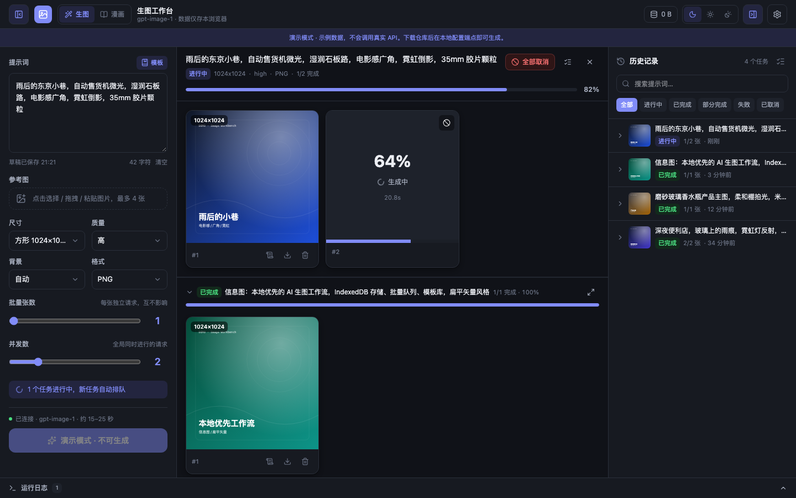
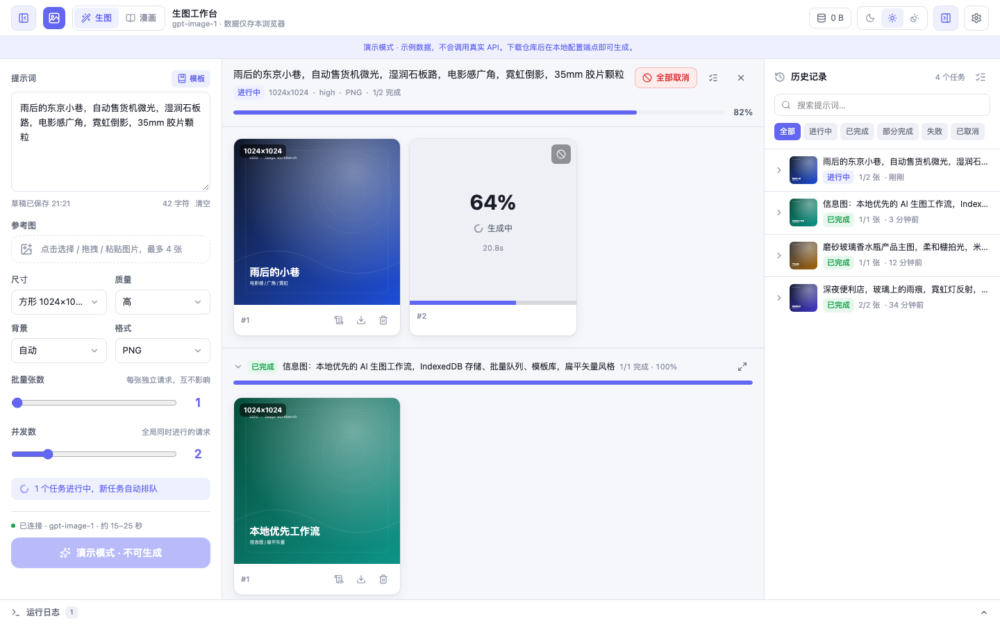
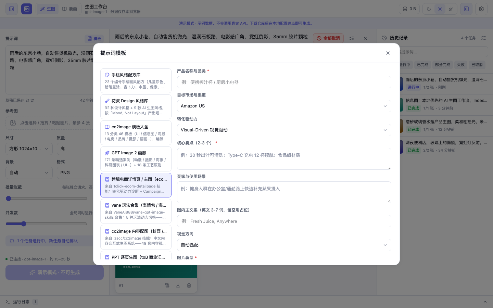

# AI 生图工作台 · Image Workbench

[](LICENSE)
[](https://github.com/mxy2316868975javascript/workbench-image/actions/workflows/ci.yml)
[](package.json)

纯浏览器端的 AI 生图工作台：支持文生图、图生图、批量生成、提示词模板与漫画工作室。图片、历史、设置和 API Key 只写入本机 IndexedDB，数据只存本机，自带 API Key（BYOK），没有后端存储。

本地演示：`npm run dev` 后打开 `http://localhost:5173/?demo=1` · [English](README.en.md) · [快速开始](#快速开始) · [第三方来源与许可](THIRD_PARTY_NOTICES.md)

> 本项目是独立开源项目，与 OpenAI 无隶属或官方合作关系。

## 目录

- [界面截图](#界面截图)
- [功能](#功能)
- [快速开始](#快速开始)
- [配置](#配置)
- [数据与隐私](#数据与隐私)
- [备份与恢复](#备份与恢复)
- [部署](#部署)
- [第三方来源与许可](#第三方来源与许可)
- [已知限制](#已知限制)
- [关键词 / Keywords](#关键词--keywords)
- [贡献](#贡献)
- [许可](#许可)

## 界面截图

| 深色主题 | 浅色主题 |
| --- | --- |
|  |  |



不配置 API Key 也可以打开 `?demo=1` 查看示例任务与图片；演示模式不会调用真实端点。GitHub Pages 部署完成后，同一参数可在 `https://mxy2316868975javascript.github.io/workbench-image/?demo=1` 使用。

## 功能

### 生成

- **流式输出**：`stream: true` 直连兼容 OpenAI 协议的端点，SSE 逐事件解析，进度块实时写入日志控制台。
- **批量生图**：1–10 张，全局并发数 1–6，队列自动调度、槽位复用，整批取消与失败重试。
- **图生图**：参考图走 `/images/edits`（multipart），支持点击选择、拖拽、剪贴板粘贴，最多 4 张；任务与历史记录带「图生图」标识，重新生成时参考图一并还原。
- **百分比进度**：每张卡片独立的百分比与进度条（时间渐近曲线 + SSE chunk 修正），批量任务显示整批均值。
- **提交预检**：提交前检查端点、Key、模型、透明背景与 JPEG 冲突、参考图数量/类型/体积，给出张数、预计时长与排队位置；中文输入法组合中不会误触 ⌘Enter。
- **草稿恢复**：左栏输入自动保存，文字镜像到 localStorage，参考图存 IndexedDB；刷新或重开浏览器后恢复并提示，支持一键清空与 5 秒撤销。
- **日志流**：底部可展开/全屏的日志抽屉，时间戳、级别着色、按单张图片过滤、自动滚动、复制。

### 历史与预览

- **历史记录**：按任务分组，查看、复制、编辑旧提示词、回填生成面板、重新生成、删除单图与整任务（级联），支持任务与图片批量删除。
- **灯箱预览**：从 IndexedDB 取原 Blob，滚轮缩放、拖拽平移、上下张切换、下载、复制提示词、元信息（耗时 / tokens / 改写后提示词）。
- **删除确认**：单图、整任务、批量删除与灯箱内删除统一确认；清空数据库需输入「清空」二次确认。
- **持久化**：刷新或关闭页面后历史与图片保留；中断的任务下次启动标记为失败，可手动重试；顶栏显示 IndexedDB 存储用量。

### 提示词模板与风格库

所有模板都从「模板」入口打开；运行时库首次使用时才联网拉取并缓存到本机。

- **跨境电商详情页 / 主图（ecom-pdp）**：来自 [1click-ecom-detailpage](https://github.com/coolqoo/1click-ecom-detailpage)，按产品 / 渠道 / 转化驱动力 / 卖点生成英文 Prompt，主图 5 种、详情页 10 种图片类型。
- **vane 玩法合集**：来自 [vane-gpt-image-skills](https://github.com/VaneAi888/vane-gpt-image-skills)，5 种玩法：表情包、电影海报、书页里的电影、宠物写真、微信红包封面。
- **电商执行卡（视觉文案 SOP）**：来自 [ecommerce-visual-copywriting-skill](https://github.com/feichanggege/ecommerce-visual-copywriting-skill)，6 种图片任务、KV1 规则、标题/副文案字数检查、证据账本与广告法提示。
- **文档配图（三风格）**：来自 [Document-illustrator-skill](https://github.com/op7418/Document-illustrator-skill)，渐变玻璃卡片、数字极简票券、扁平矢量插画。
- **cc2image 模板大全**：来自 [awesome-gpt-image-2](https://github.com/freestylefly/awesome-gpt-image-2)，13 分类 46 模板，编辑 `[]` 占位符即出 Prompt；按需拉取。
- **Gorden 图片型 PPT**：来自 [GordenSuperPPTSkills](https://github.com/GordenSun/GordenSuperPPTSkills)，七段式信息图结构、19 种视觉框架、9 种风格库；按上游要求保留署名。
- **PPT 逐页生图**：来自 [codex-ppt-skill](https://github.com/Ronnie2025/codex-ppt-skill)，全局风格块 + 逐页提示词，13 种版式。
- **cc2image 内容配图**：来自 [cc2image](https://github.com/izscc/cc2image)，封面 / 正文 / logo 三种模式，49 套中文内容风格 + 8 套图标风格。
- **小黑怪诞正文配图**：来自 [ian-xiaohei-illustrations](https://github.com/helloianneo/ian-xiaohei-illustrations)，固定 IP 角色 + 手绘线稿 + 红橙蓝批注。
- **花叔 Design 风格库**：来自 [huashu-design](https://github.com/alchaincyf/huashu-design)，92 种设计风格 + 9 款 AI 生图风格，按「Mood, Not Layout」产出短 Prompt；按需拉取。
- **极简 Zine 海报**：来自 [gc-minimal-zine-poster](https://github.com/LiamGvchi/gc-minimal-zine-poster)，纸感留白与单一高饱和色。
- **论文方法图解**：来自 [paper-craft-skills](https://github.com/zsyggg/paper-craft-skills)，sketchnote 与 paper-figure 两种风格。
- **手绘风格配方库**：来自 [hand-drawn-styles](https://github.com/threerocks/hand-drawn-styles)，23 个编号画风配方；按需拉取。
- **GPT Image 2 精选画廊**：来自 [GPT-Image2-Skill](https://github.com/wuyoscar/GPT-Image2-Skill)，171 条编号案例 + 提示词工艺原则；按需拉取。
- **自定义模板**：正文用 `{{key}}` 占位 + 字段定义，模板存 IndexedDB。

### 漫画工作室

- **角色设定**：描述 + 参考图生成角色六宫格设定表，作为后续分镜的一致性参考。
- **AI 剧本与分镜**：文本端点与生图端点解耦，脚本、分镜、逐格生图、导出。
- **独立设置**：漫画文本端点、Key、模型单独保存，不混用生图配置。

### 界面

- 深色 / 浅色 / 跟随系统三档主题。
- 左右侧栏一键收起/展开，宽度过渡动画，偏好写入 localStorage。
- 窄屏（<1024px）自动切换「生成 / 看板」页签；多任务并行时最近 6 个任务持续可见。

## 快速开始

环境要求：Node.js >= 20.19（推荐 22 LTS）、npm 10+、较新的 Chrome / Edge / Safari / Firefox。

```bash
npm ci
cp .env.example .env.local   # 可选：填写端点与模型；不要写真实 Key
npm run dev                  # http://localhost:5173
```

首次打开若未配置端点或密钥，会自动弹出设置面板。所有配置（含密钥）只存本浏览器 IndexedDB。

常用命令：

```bash
npm run lint       # ESLint
npm test           # Vitest
npm run typecheck  # tsc
npm run build      # 类型检查 + 生产构建
npm run preview    # 本地预览 dist
```

## 配置

### 环境变量

| 变量 | 作用 | 默认值 |
| --- | --- | --- |
| `VITE_DEFAULT_BASE_URL` | 生图端点 Base URL | `/api/relay/v1` |
| `VITE_DEFAULT_API_KEY` | 生图密钥（仅 dev 生效） | 空 |
| `VITE_DEFAULT_MODEL` | 生图模型 | `gpt-image-1` |
| `VITE_TEXT_BASE_URL` | 文本端点（漫画脚本 / 分镜） | `/api/relay/v1` |
| `VITE_TEXT_API_KEY` | 文本密钥（仅 dev 生效） | 空 |
| `VITE_TEXT_MODEL` | 文本模型 | `gpt-4o-mini` |
| `RELAY_TARGET` | 内置 relay 的上游地址（仅 dev / preview） | `https://api.openai.com` |

**密钥安全**：`VITE_*` 会被 Vite 打包进前端产物，等同于公开信息。生产构建检测到名称像密钥的 `VITE_*` 非空会直接失败；真实 Key 请在应用「设置」面板填写，只存 IndexedDB。开发环境可以用 `.env.local`，但不要提交。

### 内置 relay

部分上游不返回 CORS 头，浏览器无法直连。`server/relay-middleware.ts` 在 dev/preview 进程内用 `node:http2` 直连上游并逐字节 pipe，只转发、不存储。relay 只接受本机回环请求（`127.0.0.1` / `::1`），并校验 Host / Origin；不要用 `--host 0.0.0.0` 把 preview 暴露到局域网或公网。

生产静态部署没有 relay，需要把设置里的 Base URL 换成支持 CORS 的端点，或自行托管带访问控制的转发层。

## 数据与隐私

- 图片、历史、设置、API Key 只写入当前浏览器的 IndexedDB；没有账号、没有后端数据库、没有遥测。
- 生成时，提示词与参考图会发送到你配置的模型端点；这是生图本身必需的网络请求。
- 部分模板库在首次点击加载时会访问 GitHub Raw / jsDelivr，只拉取模板文本与示例图地址，不上传你的提示词或图片。
- API Key 在 IndexedDB 中不加密。任何能执行脚本的 XSS、恶意浏览器扩展或有权限的本地用户都可能读到它；建议使用限额、可随时吊销的 Key。
- 换浏览器、清理站点数据或使用隐私模式会导致本地数据不可用；需要迁移时请用「设置 → 数据备份」。

## 备份与恢复

设置面板提供「导出备份 / 导入备份」：

- 导出内容：全部任务、图片、自定义模板、漫画项目、生图设置和漫画设置。
- 默认排除：两个 API Key、模板库缓存、左栏草稿。
- 图片以 base64 写入单个 JSON，文件会比原始图片大约 33%；图片很多时建议分批或先清理历史。
- 导入会覆盖当前任务、图片、自定义模板和漫画项目；设置合并，但保留当前浏览器里的 Key。导入前会显示数量并二次确认。

## 部署

```bash
npm run build   # 输出 dist/
```

`dist/` 是纯静态文件。部署到 Vercel / Netlify / Cloudflare Pages / GitHub Pages 时，默认的 `/api/relay/v1` 不可用，需要在设置面板改成支持 CORS 的端点，或自建转发层。

GitHub Pages 演示由 `.github/workflows/pages.yml` 构建：设置仓库 Settings → Pages → Source 为 GitHub Actions，之后 push `main` 会部署只读演示（`https://mxy2316868975javascript.github.io/workbench-image/?demo=1`）。演示模式不读取任务与设置数据，也不调用真实 API；打开模板库时仍可能读取本地缓存或联网拉取。

## 第三方来源与许可

本项目代码以 [MIT](LICENSE) 发布。`src/lib/` 中整理或运行时加载的第三方提示词、模板、风格库与示例数据版权归各上游作者所有，按 [THIRD_PARTY_NOTICES.md](THIRD_PARTY_NOTICES.md) 列出的许可使用，不适用本项目的 MIT 许可。

- 运行时按需加载：`awesome-gpt-image-2`、`GPT-Image2-Skill`、`hand-drawn-styles`、`huashu-design`（均 MIT，URL 固定到 commit）。
- 代码内嵌模板：`1click-ecom-detailpage`、`vane-gpt-image-skills`、`cc2image`、`codex-ppt-skill`、`GordenSuperPPTSkills`、`ecommerce-visual-copywriting-skill`、`Document-illustrator-skill`、`paper-craft-skills`、`ian-xiaohei-illustrations`、`gc-minimal-zine-poster`。
- 早期版本中出现过的 AGPL / 非商业 / 无许可内容已移除，不再随本仓库分发；详见 NOTICES 的「已移除的内容」。

新增第三方内容前请先看 [CONTRIBUTING.md](CONTRIBUTING.md) 的许可规则：没有明确许可的内容不要合入。

## 已知限制

- 没有后端存储，也没有账号同步；数据只存在当前浏览器配置里。
- relay 只用于本机 dev/preview，不能当作生产转发层。
- 运行时模板库依赖上游 GitHub / jsDelivr 可用性；首次加载需要联网，之后读本地缓存。
- 端点必须兼容 OpenAI 的图片生成 / 编辑协议；不同代理的事件格式可能不同。
- 图片备份是单文件 base64 JSON，超大历史可能超过浏览器内存或存储配额。
- 漫画工作室的文本能力依赖单独的文本端点，未配置时脚本 / 分镜功能不可用。

## 贡献

欢迎 issue 与 PR。流程、代码风格和第三方内容规则见 [CONTRIBUTING.md](CONTRIBUTING.md)。安全问题请不要开公开 issue，按 [SECURITY.md](SECURITY.md) 私密报告。

## 关键词 / Keywords

AI 生图、文生图、图生图、批量生图、提示词模板、本地优先、数据隐私、浏览器端、IndexedDB、BYOK；AI image generation, text-to-image, image-to-image, gpt-image, prompt templates, local-first, privacy-first, browser-only, bring your own key.

## 许可

[MIT](LICENSE) © 2026 Lemon。第三方内容许可见 [THIRD_PARTY_NOTICES.md](THIRD_PARTY_NOTICES.md)。
